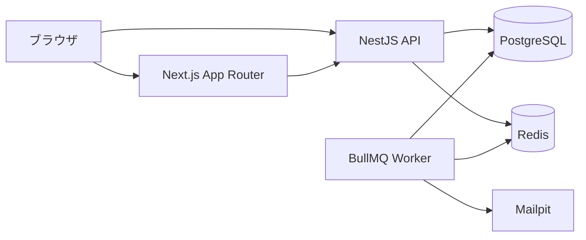

# アーキテクチャ

## 技術スタック

| 領域 | 採用 |
|---|---|
| フロントエンド | Next.js / React / TypeScript |
| バックエンド | NestJS / TypeScript |
| メインDB | PostgreSQL / Drizzle |
| 一時データ・キャッシュ | Redis |
| ジョブ処理 | BullMQ / Outbox |
| メール確認 | Mailpit |
| 実行 | Docker Compose |
| 単体テスト | Vitest |
| API結合テスト | Vitest / Supertest |
| CI | GitHub Actions |

## モジュラーモノリス

NestJS単一プロセスで機能の境界を作り、モジュール間は公開されたServiceや明示的な契約を通して連携します。クライアントUIとAPIは独立したアプリです。



### バックエンドの依存関係

```text
src/
  app.ts                NestJSモジュールの組み立て
  db.ts                 DB接続（インフラ）
  schema.ts             DBスキーマ
  auth.ts               認証Controller・Service
  products.ts           商品Controller
  orders.ts             注文Controller
  orders.service.ts     注文ユースケース・取引制御
  customer.ts           顧客情報
  discovery.ts          レコメンド・ランキング
  admin.ts              管理
  guest.ts              ゲスト購入
  media.ts              画像
  security.ts           Origin検証・Rate Limit
  worker.ts             非同期処理
```

ControllerはHTTP入出力に集中し、Serviceはユースケースと取引境界、Repositoryは永続化処理を担当させる設計を目指します。現状一部の機能はControllerにSQLが残るため、今後の整理対象です。

### フロントエンド

```text
src/
  app/                  ルーティング・ページ
  components/           再利用するUI
  lib/api.ts            APIクライアント
  hooks/                状態管理・データ取得（必要に応じ追加）
```

## 設計上の重要事項

1. 決済やメールなどDB外の処理は、単一のDBトランザクションには含めない。
2. 在庫引当は行ロックと条件検証で保護する。
3. 同じ注文要求を再送しても二重発注しないよう冪等性キーで制御する。
4. イベント送信はOutboxを使い、Redisキューの一時障害とDB更新を切り離す。
5. 認可はフロントエンドの表示制御だけに依存せず、APIで必ず検証する。
6. ローカル学習専用。実用システムへの流用にはCSRF・セッション・決済・個人情報保護の追加監査が必要。
