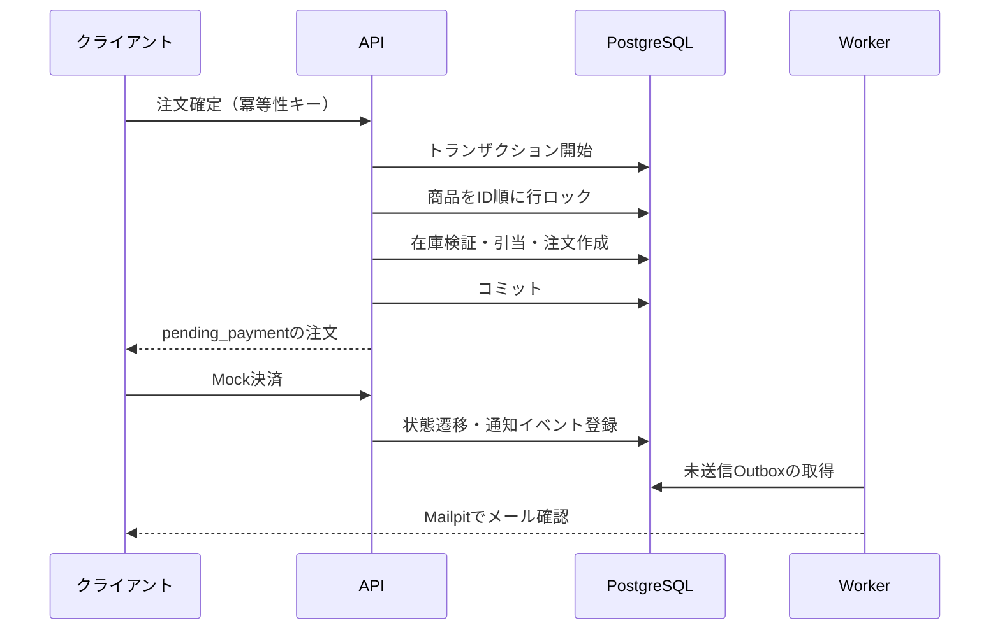

# データモデル・注文処理

## 主要テーブル

| テーブル | 内容 |
|---|---|
| users / sessions | 会員・ログイン状態 |
| products / categories | 商品・カテゴリ・SKU |
| carts | 会員カート |
| orders / order_items | 注文ヘッダと購入時の明細スナップショット |
| coupons | 割引率 |
| reviews / review_votes | 購入者レビューと役立った投票 |
| favorites / view_history | お気に入り・閲覧履歴 |
| addresses | 配送先 |
| outbox | 送信予定イベント |
| payment_events | Mock Webhook等の重複検出 |
| audit_logs | 管理者操作履歴 |
| price_history | 価格変更履歴 |

## 注文処理



在庫引当を注文作成時に行うため、決済未完了の注文を一定時間後に期限切れへ変更し、在庫を解放する設計です。注文キャンセルも二重返却しないよう注文行のロックを使用します。

### 状態遷移

```text
pending_payment -> paid | payment_failed | cancelled | expired
payment_failed -> paid | cancelled | expired
paid -> shipped | cancelled | refunded
shipped -> delivered
delivered -> refunded
```

返金はMockモードでのみ扱います。現金の移動や外部決済への返金依頼はありません。

### 金額計算

金額は日本円の整数で保持します。割引額は `floor(小計 × 割引率 / 100)`、割引後の小計が5,000円以上なら送料無料、それ未満なら500円です。計算はサーバー側で実行します。
